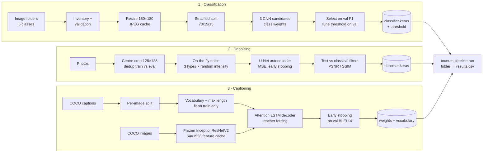

# TouNum Vision Pipeline

**A three-stage deep-learning pipeline for scanned archives: it detects the photographs, removes their noise and writes a caption for each one.**

Built with TensorFlow / Keras. This repository is the production-grade refactor of three
research notebooks from an engineering-school group project (CESI, *TouNum* case study):
the experiments were turned into a tested, configurable and reproducible Python package
with a command-line interface. The package does not depend on any notebook; the original
notebooks are kept in [`notebooks/`](notebooks/) for reference, with their executed outputs.

```text
scanned image ──► 1. Photo or other? ──► 2. Denoising ──► 3. Caption
                    (CNN classifier)      (U-Net autoencoder)  (CNN + attention LSTM)
```

---

## 1. Problem and objectives

A digitisation company receives large volumes of scanned documents: photographs, but also
paintings, schematics, sketches and text pages. The goal is to automatically:

1. **sort** the photographs from every other kind of document;
2. **clean** the photographs (sensor grain, dust, speckle);
3. **describe** each photograph with an English caption, to make the archive searchable.

Engineering objectives of this refactor:

* one installable package and one CLI instead of three notebooks run by hand;
* a single YAML configuration and paths that do not depend on the working directory;
* explicit data validation, leakage guards and reproducible seeds;
* models saved with their preprocessing metadata and reusable without retraining;
* an automated test suite on synthetic data that runs without the private datasets.

## 2. Data

| Module | Data | Split |
|---|---|---|
| Classification | TouNum dataset, 5 classes: Painting, Photo, Schematics, Sketch, Text (41 399 images). `Photo` → 1, others → 0 | stratified on the source class: 70 / 15 / 15 |
| Denoising | train: 4 000 photos of the `Photo` class; validation and test: 74 + 74 photos of a separate dataset. Noise is **simulated** (gaussian, salt & pepper, speckle at 3 intensities) | evaluation set shuffled and cut in half |
| Captioning | MS COCO 2014 `train2014` + `captions_train2014.json` (5 captions per image) | **per image**: 1 000 test, 1 000 validation, 40 000 train |

The TouNum images are not public and are not included; MS COCO must be downloaded from its
official site. See [`data/README.md`](data/README.md) for the expected layout.

## 3. Tech stack

Python 3.10+ · TensorFlow / Keras 3 · NumPy · pandas · Pillow · SciPy · scikit-learn · NLTK (BLEU) · PyYAML · pytest · Ruff

## 4. Architecture



Detailed design and data flow: [`docs/architecture.md`](docs/architecture.md).

## 5. Methodology

### Module 1 - Photo / other classifier
* **Preprocessing:** RGB, 180×180 bilinear resize, cached once as JPEG; normalisation is a
  `Rescaling` layer *inside* the model, so training and inference share it.
* **Models compared on validation:** a 3-block reference CNN, a regularised CNN
  (flip / rotation / zoom augmentation, dropout 0.2 / 0.25) and a 4-block CNN.
* **Imbalance:** "balanced" class weights computed on the training set only; the model is
  selected on the validation **F1 macro** (accuracy alone would reward predicting "other").
* **Decision threshold** tuned on the validation set; the test set is used **once**, at the end.
* **Error analysis** per source class (e.g. false-positive rate of paintings).

### Module 2 - Denoising autoencoder
* Noisy/clean pairs are generated on the fly: the noise changes every epoch, so the model
  cannot memorise noisy images. Validation and test noise is drawn once with fixed seeds,
  so every method is compared on identical inputs.
* Four architectures (base, wider, **U-Net skip connections**, strided convolutions), then
  loss and learning rate, then single-noise vs **mixed-noise** training, one change at a time.
* Benchmarked against mean, gaussian and median filters, plus a "do no harm" check on clean photos.

### Module 3 - Image captioning (transfer learning)
* A frozen ImageNet CNN turns each image into an 8×8 grid of features (64 regions), computed
  once and cached; a Bahdanau-attention RNN writes the caption word by word.
* Architecture A (workshop): InceptionV3 + GRU + zero initial state.
  Architecture B (retained): **InceptionResNetV2 + LSTM + initial state computed from the image**.
* Masked cross-entropy with teacher forcing; early stopping on the **validation BLEU-4** of
  captions written by the model alone (greedy decoding).

## 6. Results

> These figures are the outputs of the **original notebooks** (see [`notebooks/`](notebooks/)), run by the project team on the
> full datasets (GPU). They were **not re-run** during this refactor, because the private
> datasets and the ImageNet weights are not available in the refactoring environment.
> Re-running `tounum <module> train` writes fresh metrics to `artifacts/<module>/<run>/metrics.json`.

**Classification - test set (6 210 images, threshold 0.78 chosen on validation)**

| Model | Accuracy | Balanced acc. | F1 macro | ROC-AUC | PR-AUC |
|---|---|---|---|---|---|
| 4-block CNN | 0.937 | 0.909 | 0.913 | 0.978 | 0.937 |
| *Constant "other" baseline* | *0.759* | *0.5* | | | |

Paintings remain the hardest class: 9.9 % of them are predicted as photos.

**Denoising - test set (74 photos, medium noise), PSNR in dB**

| Noise | No filter | Best classical filter | Autoencoder (A2, mixed) |
|---|---|---|---|
| Gaussian | 20.4 | 25.3 (gaussian) | **28.7** |
| Salt & pepper | 17.9 | 28.5 (median) | **32.4** |
| Speckle | 18.8 | 24.4 (gaussian) | **28.2** |

The autoencoder beats every filter in all 9 noise × intensity cases; on clean photos it keeps
34.4 dB / SSIM 0.97 (it does not damage them).

**Captioning - test set (1 000 COCO images, greedy decoding)**

| Model | BLEU-1 | BLEU-4 |
|---|---|---|
| Architecture B, 40 000 training images | 0.705 | 0.267 |

Comparable in order of magnitude to *Show, Attend and Tell* (Xu et al., 2015: 0.70 / 0.24), with
different test images and tokenisation, so not a like-for-like comparison.

## 7. Installation

```bash
git clone https://github.com/HamzaOuba00-1/tounum-vision-pipeline.git
cd tounum-vision-pipeline
python -m venv .venv
source .venv/bin/activate            # Windows PowerShell: .venv\Scripts\Activate.ps1
pip install -r requirements-dev.txt  # or requirements.txt for runtime only
pip install -e .
```

`requirements.txt` pins the CPU build of TensorFlow; on a CUDA machine install
`tensorflow[and-cuda]` instead. The captioning module downloads the ImageNet weights of its
CNN from Keras on first use.

## 8. Usage

```bash
tounum check-data                       # verify the datasets are in place

tounum classify train                   # module 1: train, select, tune, test once
tounum denoise compare                  # module 2: optional architecture comparison
tounum denoise train                    # module 2: final model
tounum caption train                    # module 3: features + training + test

tounum classify predict scan1.jpg scan2.png
tounum denoise apply photo.jpg --output photo_clean.png
tounum caption predict photo.jpg

# end-to-end on a folder of scans (latest runs, or --classifier-run/... to choose)
tounum pipeline run --input scans/ --output results/
```

Every training command writes to a **new** folder `artifacts/<task>/<timestamp>/` (model,
metadata, metrics, histories, splits, the configuration used) and refuses to overwrite an
existing one. All settings live in [`configs/config.yaml`](configs/config.yaml); use
`--config other.yaml` for an experiment.

Already have the models trained by the notebooks? Import them instead of retraining:

```bash
tounum import-legacy --classifier-dir livrable1_artifacts \
                     --denoiser-file debruiteur_final.keras \
                     --captioner-dir livrable3_artifacts
```

## 9. Tests and code quality

```bash
pytest          # 69 tests, ~1 min on CPU, no dataset needed
ruff check src tests && ruff format --check src tests
```

The tests generate synthetic images and a fake COCO, and replace the ImageNet CNN with a tiny
model of the same output shape. They cover ingestion and validation, splits and leakage guards,
**pixel-identical preprocessing between training and prediction**, metrics and threshold
selection, noise models, every architecture (parameter counts identical to the notebooks),
the vocabulary (index-for-index identical to the Keras tokenizer used originally), end-to-end
training of the three modules, model reloading, the pipeline and the CLI.

## 10. Project structure

```text
tounum-vision-pipeline/
├── configs/config.yaml          # every parameter, notebook values by default
├── data/README.md               # how to obtain and place the data
├── docs/
│   ├── architecture.md          # design and data flow
│   └── notebook_migration.md    # what changed vs. the notebooks, and why
├── notebooks/                   # original research notebooks (reference only, with outputs)
├── src/tounum/
│   ├── config.py                # typed config, validation, path resolution
│   ├── cli.py                   # `tounum` command
│   ├── data_checks.py
│   ├── classification/          # data · model · train · evaluate · predict
│   ├── denoising/               # data · noise · filters · models · train · predict
│   ├── captioning/              # data · text · features · model · metrics · train · predict
│   ├── pipeline/                # end-to-end inference · legacy model import
│   └── utils/                   # logging · seeds · run folders and atomic writes
├── tests/                       # pytest suite on synthetic data
├── artifacts/                   # training runs (git-ignored)
├── pyproject.toml · requirements*.txt · Makefile
```


