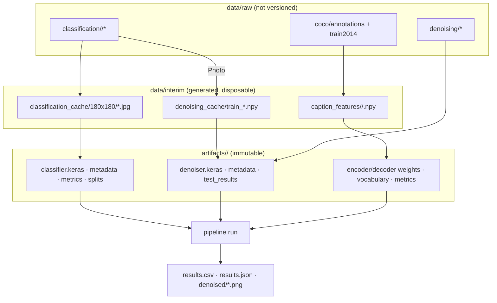

# Architecture

## Design principles

* **One responsibility per module.** Each stage has the same shape:
  `data` (ingestion, validation, preprocessing) → `model` (architectures) →
  `train` (protocol, writes a run folder) → `evaluate` / `metrics` → `predict`
  (loads a run, no retraining).
* **Configuration, not code edits.** Every parameter of the notebooks is in
  `configs/config.yaml`, loaded into typed dataclasses (`tounum.config`). Unknown keys and
  invalid values fail fast. Relative paths are resolved against `paths.root`, itself relative
  to the YAML file, never against the current directory.
* **Preprocessing travels with the model.** Normalisation is inside the Keras models; the
  metadata saved next to each model (image size, threshold, vocabulary, max length, CNN name)
  is what the predictors read.
* **Immutable runs.** `artifacts/<task>/<run>/` is created by `create_run_dir`, which refuses to
  reuse a non-empty folder. JSON files are written atomically.
* **Heavy imports are lazy.** TensorFlow is imported inside functions where possible so that
  `tounum check-data` and the configuration stay fast.

## Package layout

```text
tounum/
├── config.py            Config dataclasses, load_config(), path helpers
├── cli.py               argparse front-end; maps commands to the functions below
├── data_checks.py       check_datasets(): presence / structure of the three datasets
├── classification/
│   ├── data.py          build_inventory, validate_inventory, load_and_resize,
│   │                    preprocess_for_model, build_image_cache, split_dataset, make_dataset
│   ├── model.py         build_classifier(variant)         reference | regularized | four_blocks
│   ├── evaluate.py      compute_metrics, select_threshold, source_class_analysis, plateau_analysis
│   ├── train.py         train_classifier(config, run_dir)
│   └── predict.py       PhotoClassifier.from_run(run).classify(paths)
├── denoising/
│   ├── data.py          read_photo (centre crop), split_eval_paths, near_duplicate_mask,
│   │                    prepare_denoising_data
│   ├── noise.py         gaussian, salt_pepper, speckle, fixed_noisy_sets
│   ├── filters.py       classical baselines, psnr_ssim
│   ├── models.py        A0_base, A1_wide, A2_unet, A3_strided (fully convolutional)
│   ├── train.py         training_dataset, train_denoiser, compare_architectures
│   └── predict.py       Denoiser.from_run(run).denoise(image), pad_to_multiple
├── captioning/
│   ├── data.py          load_captions, split_image_ids (per image)
│   ├── text.py          clean_caption, Vocabulary (Keras-Tokenizer-compatible), padding
│   ├── features.py      create_extractor, cache_features, load_features, read_image_299
│   ├── model.py         CNNEncoder, BahdanauAttention, RNNDecoder, generate
│   ├── metrics.py       corpus / sentence BLEU
│   ├── train.py         prepare_text, fit_captioner (custom loop), train_captioner
│   └── predict.py       Captioner.from_run(run).caption_paths / caption_arrays
├── pipeline/
│   ├── inference.py     run_pipeline(input_dir, output_dir, classifier, denoiser, captioner)
│   └── legacy.py        import the .keras / .h5 / .json files saved by the notebooks
└── utils/               logging_config, reproducibility (seeds, GPU), runs (folders, JSON/CSV)
```

## Data flow



## Leakage guards

| Risk | Guard |
|---|---|
| Same image in two classification splits | `assert_disjoint` after every split; splits saved to CSV |
| Statistics learned on non-training data | class weights from the training labels only; vocabulary and max caption length from training captions only |
| Model / threshold chosen on the test set | selection and threshold on validation; test evaluated once at the end of `train_*` |
| Denoising training photos duplicated in evaluation | 16×16 thumbnail near-duplicate removal |
| Same COCO photo with another caption in evaluation | split per image, not per caption |
| Train/serve preprocessing mismatch | `preprocess_for_model` reproduces the cache (PIL resize → JPEG q95 → TF decode); tested pixel for pixel |

## Inference pipeline

`run_pipeline` receives already-loaded models (dependency injection), which keeps it testable
with stubs. For each image: classifier probability → if `>= threshold`, load the full image,
denoise it (reflect padding to a multiple of 4, optional `max_denoise_side`), save it as PNG and
caption the denoised array (resized to 299×299 exactly like the feature cache). Unreadable files
are reported with `status = "error"` instead of stopping the run.
